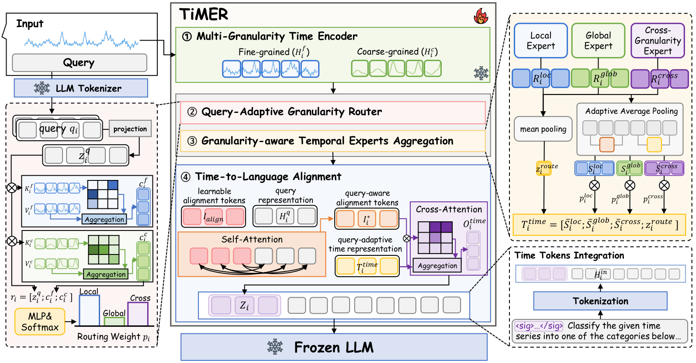

<div align="center">


<h1>Bridging Time Series and Language via Query-Adaptive Multi-Granularity<br>Routing for Temporal Reasoning</h1>

<p>
  
  
  
</p>

<p>
  <a href="https://idsl.hanyang.ac.kr/members/students/%EC%A0%84%ED%98%84%EC%95%84"><strong>Hyuna Jeon<sup>†</sup></strong></a>
  &nbsp;&nbsp;
  <strong>Jaeyoung Lee<sup>†</sup></strong>
  &nbsp;&nbsp;
  <strong>Misuk Kim<sup>*</sup></strong>
</p>

<p>
  <small><sup>†</sup> Equal contribution &nbsp;&nbsp;&nbsp; <sup>*</sup> Corresponding author</small>
</p>

<p>
  📄 <a href="#-citation"><strong>Paper</strong></a> (Coming Soon)
  &nbsp; | &nbsp;
  🤗 <a href="https://huggingface.co/datasets/TSAQA/TSAQA-Benchmark"><strong>Dataset</strong></a>
</p>

</div>

---

TiMER connects numerical time-series representations with language models through **multi-granularity temporal encoding**, **query-adaptive expert routing**, and **time-to-language alignment**. The framework dynamically combines local, global, and cross-granularity evidence according to the input question; its recommended configuration keeps both the time encoder and language model frozen.

This repository provides self-contained training and evaluation entry points for both **Frozen-LLM** and **LoRA** settings.

## 🔭 TiMER Overview

<p align="center">
  <a href="Figure/TiMER_Overview.pdf">
    
  </a>
</p>

<p align="center"><em>Click the figure to open the full-resolution PDF.</em></p>

TiMER consists of four main stages:

1. **Multi-Granularity Time Encoder (MTE)** extracts fine- and coarse-grained temporal representations.
2. **Query-Adaptive Granularity Router (QGR)** predicts question-conditioned weights for the local, global, and cross-granularity experts.
3. **Granularity-aware Temporal Experts Aggregation** adaptively pools and combines the routed representations.
4. **Time-to-Language Alignment** maps the resulting time tokens into the language-model representation space before integrating them with the text tokens.

## ✨ Highlights

- **Question-aware routing:** selects temporal evidence according to what the question asks.
- **Multi-granularity reasoning:** jointly models local, global, and cross-granularity patterns.
- **Parameter-efficient adaptation:** supports a frozen LLM as well as LoRA fine-tuning.
- **Reproducible evaluation:** reports sample-level predictions, accuracy, and MoE routing statistics.
- **Built-in ablations:** supports `raw`, `fine`, `coarse`, `fused`, `moe`, `moe_without_routing`, and `signal_moe` signal paths.

## 📦 Resources

| Resource | Description | Link |
|---|---|---|
| **TiMER** | Training and evaluation code | This repository |
| **TSAQA** | Time Series Analysis Question Answering Benchmark | [🤗 Dataset](https://huggingface.co/datasets/TSAQA/TSAQA-Benchmark) |
| **MTE checkpoint** | Pretrained multi-granularity time encoder | [`MTE/checkpoint/gft_varlen_best_forecast.pt`](MTE/checkpoint/gft_varlen_best_forecast.pt) |
| **Architecture** | Full-resolution TiMER overview | [PDF](Figure/TiMER_Overview.pdf) |

## 🚀 Quick Start

### Installation

Python 3.11 and a CUDA-enabled PyTorch environment are recommended.

```bash
git clone https://github.com/hyuna0926/TiMER_paper.git
cd TiMER_paper

conda create -n timer python=3.11 -y
conda activate timer

# Install PyTorch for your CUDA setup first, then the core dependencies.
pip install torch
pip install transformers peft accelerate pandas pyarrow numpy tqdm
```

The complete reference environment is recorded in [`requirements.txt`](requirements.txt).


### Train and Evaluate

The provided script runs the recommended Frozen-LLM configuration with Qwen3-0.6B:

```bash
bash scripts/qwen_frozen.bash
```

Paths and the visible GPU can be overridden without editing the script:

```bash
DATA_DIR=/path/to/TSAQA \
OUTPUT_DIR=/path/to/checkpoints \
MTE_CKPT=/path/to/gft_varlen_best_forecast.pt \
CUDA_VISIBLE_DEVICES=0 \
bash scripts/qwen_frozen.bash
```

The best checkpoint is written to `${OUTPUT_DIR}/best`, and evaluation results are saved as `${OUTPUT_DIR}/eval_results.csv`.

## 🏋️ Training

### Frozen LLM

```bash
python train2_adaptive.py \
  --frozen_llm \
  --model_name "Qwen/Qwen3-0.6B" \
  --train_path "data/TSAQA/train.parquet" \
  --val_path "data/TSAQA/val.parquet" \
  --gft_ckpt "MTE/checkpoint/gft_varlen_best_forecast.pt" \
  --output_dir "checkpoints/qwen3_0.6b" \
  --num_epochs 30 \
  --batch_size 8 \
  --grad_accum 4 \
  --max_seq_len 4096 \
  --max_ts_len 512 \
  --lr 1e-4 \
  --num_qformer_queries 25 \
  --top_k 3 \
  --early_stopping_patience 3
```


## 📊 Evaluation

Use the same model mode and architecture settings used during training:

```bash
python eval2_adaptive.py \
  --frozen_llm \
  --model_name "Qwen/Qwen3-0.6B" \
  --checkpoint_dir "checkpoints/qwen3_0.6b/best" \
  --gft_ckpt "MTE/checkpoint/gft_varlen_best_forecast.pt" \
  --test_path "data/TSAQA/test.parquet" \
  --output_path "checkpoints/qwen3_0.6b/eval_results.csv" \
  --max_seq_len 4096 \
  --num_qformer_queries 25 \
  --top_k 3
```

The output CSV contains the ground-truth answer, model prediction, correctness, question type, task, domain, and local/global/cross-granularity routing weights for each sample. Aggregate accuracy is also reported by question type and task.

## 📁 Repository Structure

```text
TiMER_paper/
├── train2_adaptive.py       # Frozen-LLM and LoRA training
├── eval2_adaptive.py        # Evaluation and routing analysis
├── MTE/                     # Multi-Granularity Time Encoder
│   └── checkpoint/          # Pretrained MTE checkpoint
├── QGR/                     # Router and temporal experts
├── Figure/                  # TiMER architecture (PNG and PDF)
├── scripts/                 # Reproducible run scripts
└── requirements.txt         # Reference Python environment
```

## 📝 Citation

If you find TiMER useful in your research, please cite our paper. The BibTeX entry will be added when the paper becomes publicly available.

---

<div align="center">

Built for research on language-model reasoning over time series.

</div>
